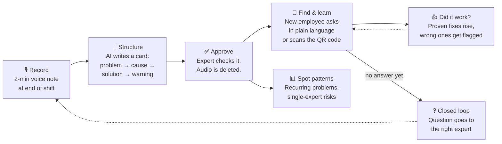

<div align="center">

# KnowFlow

### Knowledge that doesn't retire.

**The AI Schichtbuch for manufacturing SMEs.**
Workers talk for 2 minutes at the end of each shift. The AI turns it into searchable know-how that new employees learn from, and that stays in the company when experienced people leave.

`Problem 03 · When the experts retire` · 8.8.8 Start-a-thon · THWS Campus 3 · 27 Nov 2026 · Team WRATHOFCODE

</div>

---

## The problem

Baby boomers are retiring, and with them go experienced technicians, foremen and engineers. What they know is written down nowhere: why the Packaging Machine jams every Monday morning, the trick that fixes it, what to check first. When they leave, the company loses it. New people learn it the hard way, through downtime, mistakes and slow onboarding.

Most factories already keep a **Schichtbuch** (shift log), but it is a paper book or an Excel file that nobody reads again. And asking experts to "write documentation" fails: they don't have the time, and they don't like writing.

## Our solution

An AI-powered Schichtbuch. Every worker logs their shift **by voice in about 2 minutes**. The AI asks three questions, turns the answers into a clean knowledge card, and builds a searchable knowledge base over time, without anyone "documenting".



| Step | What happens |
|---|---|
| **1. Record** | At the end of the shift the worker taps one button and talks, no forms. Experts (5+ years) are asked: *What was difficult today? How did you fix it? What should the next person watch out for?* Newer workers are asked: *What was difficult or unclear? What did you try, and did it work? Who helped you, and what did they tell you?* |
| **1b. Machine found automatically** | The AI finds the machine in what was said (German or English, e.g. "Presse 2" → Press 2). If none is named, it uses the person's machine from the shift plan. The worker sees "Detected: Packaging Machine" and can change it before approving. |
| **2. Structure** | The AI turns the messy voice note into a card: problem → cause → solution → warning, tagged with machine, process, author and date. If a newer worker passes on an expert's tip, the card becomes "Tip from Herr Müller, shared by Ahmed" and only Herr Müller can approve it. If nobody could help, the question goes to the experts. |
| **3. Find and learn** | A new employee asks in plain language ("packaging line jams, what do I do?") and gets the answer from real past entries, with who solved it and when. |
| **4. Spot patterns** | The dashboard flags repeats and risks: "Packaging Machine: jam problem 4 times in the last 30 days", "Only Herr Müller has solved problems on Packaging Machine (retires in 6 months)." |
| **5. Practise** | The **Fix-it Challenge** turns approved cards into a short game for new employees: a situation, 4 choices, what happens with each, and the expert's real tip. |

## Features

**Core (built in this prototype)**

- 🎙️ **Voice, not typing.** 2 minutes at the machine, in normal German. Whisper handles the speech-to-text.
- 🧠 **The AI does the documenting.** Messy talk in, clean structured card out. It never invents facts: missing fields stay empty.
- ✅ **Expert approves before it goes live.** The AI drafts the card, and the expert can edit, approve or reject it.
- 📱 **A QR code on every machine.** Scan it to see the experts' approved fixes for exactly that machine, proven ones first.
- 👍 **"Did this work?" button.** Cards show their confidence and "last confirmed" date. Fixes that fail more often than they work are flagged as outdated.
- ❓ **Closed loop.** A question nobody could answer becomes the next question the AI asks the expert who knows that machine.
- ⚠️ **Mistake library.** Cards can record "what went wrong", not only "what worked".
- 🗣️ **Meeting recording.** Recording starts only after everyone consents. It pulls out decisions with their reasons, problems and solutions, lessons, and action items with owners. Lasting points become cards.
- 🗺️ **Knowledge-risk map.** Shows which machines depend on one person who retires soon.
- 🌍 **Language bridge.** Record in German or English (auto-detected). Ask in any language and get the answer in that language.
- 🎮 **Fix-it Challenge.** A training game built from approved cards: situation → big answer buttons → what happens → the expert's approved tip, word for word → a badge. Nothing about the player is stored.
- 🛡️ **No made-up knowledge.** Silent or empty recordings are rejected instead of turned into cards. Answers come only from approved cards and always name the source. The AI never speaks as the expert.

**Roadmap (in the pitch, not in the demo):** video capture for hands-on fixes · reading existing manuals first · event-triggered questions from machine/MES faults · contradiction check between experts · learning levels and quizzes for new hires · promoting good fixes to the official process, with version history.

### Privacy by design

> **This is for sharing knowledge, never for judging employees.** Entries are about the work, not the person. There is no performance scoring. In Germany, monitoring performance would also need the works council's agreement.

- Shift audio is **deleted once the card is approved**. Meeting audio is never stored. Only the approved text is kept.
- Meetings cannot be recorded without `consent=true` from everyone (the API returns `400` without it). Recording a conversation without consent is illegal in Germany.
- Every card carries the expert's name. **Credit, not control:** it is their legacy.

## Demo script (2 minutes)

The demo runs on one laptop at **http://localhost:8000**. Start the server, open the app, and run **Dashboard → ↺ Reset demo data** once before you go on stage. Have the printed **Packaging Machine** sign ready (also on the slide).

| Time | Click | Say |
|---|---|---|
| 0:00 | **Record** tab · person = *Herr Müller* · machine = *Packaging Machine* · tap 🎙️ | "Meet Herr Müller. 32 years here. Every Monday morning the Packaging Machine jams, and he's the only one who knows why. He retires in 6 months." |
| 0:10 | Talk ~20 s: *"Monday morning, the film jammed again. The hall was cold over the weekend, so the film gets stiff. I let it warm up 10 minutes at low speed, then checked the film roll tension."* · tap **✓ Done** | "At the end of his shift he just talks. No typing." |
| 0:35 | The card slides in (problem · cause · solution · watch out) · tap **✓ Approve** | "The AI writes the card. He checks it and approves it. The recording is deleted. Only his approved words stay." |
| 0:50 | **Dashboard** | "KnowFlow spots it: jam problem 4 times this month, and only Herr Müller knows the fix." |
| 1:00 | Hold up the printed **Packaging Machine** sign · switch person to *Ahmed* · Dashboard → **QR codes → Packaging Machine → Open page** | "In the factory, this sticker is on the machine. Ahmed started last month. The machine jams, so he scans it…" |
| 1:15 | Machine page: Müller's tip with *Approved by Herr Müller* · tap **👍 Worked** | "…and gets Herr Müller's fix, with his name on it. It worked, so he taps Worked. Proven fixes rise to the top." |
| 1:30 | **🎮 Fix-it Challenge** · pick the right answer → *Herr Müller's approved tip* → 🏅 badge | "New people practise on real cases from their own factory, not a generic course." |
| 1:50 | — | "Herr Müller retires in 6 months. His answers stay. **KnowFlow.**" |

**Backup:** if Wi-Fi or the AI fails, the app falls back to built-in rules automatically, and there is a recorded video of the whole flow. Ask the team for `KnowFlow-backup-demo.mp4`.

The seed data is built around this story. Run `POST /admin/reset-demo` between rehearsals to reset it.

---

## Tech

| Part | Choice | Why |
|---|---|---|
| Backend | **Python · FastAPI** | A few clear endpoints, with auto-generated docs at `/docs` |
| Brain | **OpenAI** chat model with strict JSON-schema outputs | Structuring, answers and meeting extraction always return valid JSON |
| Speech-to-text | **OpenAI Whisper** | Handles German shop-floor speech well |
| Storage | **SQLite** | One file, zero setup, enough for a pilot |
| Search | All approved cards plus the question go into one prompt | With 15–500 cards that fits in one prompt, so no vector DB is needed |
| QR codes | `segno` → SVG | Printable, scales cleanly |
| Frontend | **Plain HTML/CSS/JS**, mobile-first, served by the backend | No build step, one URL for app + API, works on any phone |
| Voice in the browser | `MediaRecorder` API | Records audio in the browser, no app install |

**Offline fallback:** if there's no API key, or the AI provider fails mid-pitch, the backend falls back to simple offline rules for structuring and keyword search. The demo never dies on stage.

```
WRATHOFCODE-START-A-THON/
├── backend/
│   ├── app/
│   │   ├── main.py      # FastAPI routes
│   │   ├── ai.py        # OpenAI brain + offline fallback (structure, ask, meetings)
│   │   ├── stt.py       # Whisper speech-to-text
│   │   ├── alerts.py    # pattern alerts + knowledge-risk map (plain rules)
│   │   ├── db.py        # SQLite schema + helpers
│   │   └── seed.py      # demo experts + 15 shift entries
│   ├── tests/test_api.py  # 15 tests covering the whole demo story
│   ├── requirements.txt
│   └── .env.example
└── frontend/            # the app (served at /)
    ├── index.html
    ├── styles.css
    └── app.js           # screens: Record · Ask · Meetings · Dashboard · QR machine page · sign · Fix-it Challenge
```

### Run it locally

```bash
git clone https://github.com/aryanthakkar221-droid/WRATHOFCODE-START-A-THON.git
cd WRATHOFCODE-START-A-THON/backend

python3 -m venv .venv && source .venv/bin/activate
pip install -r requirements.txt

cp .env.example .env          # add OPENAI_API_KEY (optional: it also runs offline)
uvicorn app.main:app --reload --host 0.0.0.0 --port 8000
```

Open **http://localhost:8000** for the app and **http://localhost:8000/docs** for the API. Demo data loads on first start.

> **Microphone on phones needs HTTPS.** Recording works on `localhost` and on any HTTPS deployment. On plain `http://<LAN-IP>` phones fall back to "Type instead"; everything else (Ask, QR pages, Dashboard) works.

### The app

| Screen | What it does |
|---|---|
| 🎙️ **Record** | Big mic button; the 3 questions shown one by one; pulsing red dot + timer → "AI is writing your card…" → the card slides in → **Approve / Edit / Discard**. Shows a colleague's open question if you're the right expert. "Type instead" fallback. |
| 🔎 **Ask** | Ask in any language → numbered steps, each with a source badge ("from Herr Müller, 3 Nov · 32 yrs"), the warning, and the source cards with **Did this work? 👍 👎**. Links like `#/ask/<question>` run a question directly. |
| 👥 **Meetings** | Consent checkbox unlocks recording → red recording bar with timer → decisions, problems, lessons, action items → **Add to knowledge base**. |
| 📊 **Dashboard** | Stats, alerts, knowledge-risk map (machines coloured by risk), drafts waiting for approval, open questions, QR codes per machine, demo reset. |
| ⚙️ **Machine page** `#/m/<id>` | What the QR code opens on a phone: the machine's alerts and approved fixes, proven first. |
| 🖨️ **Sign** `#/sign/<id>` | Printable A4 sign with the machine name and QR code. |

Tap the name in the top-right to switch person (e.g. Herr Müller → Ahmed) during the demo.

### Put it online (so the jury's phones can scan the QR codes)

**Fastest, about 1 minute, from the laptop that runs the server:**

```bash
brew install cloudflared                        # once
cloudflared tunnel --url http://localhost:8000  # prints https://<random>.trycloudflare.com
```

Then restart the server with `KNOWFLOW_PUBLIC_URL=https://<random>.trycloudflare.com` in `backend/.env`, and print the signs from **Dashboard → QR codes**. The link stays the same only while that command runs, so print the signs after starting it. HTTPS also makes the microphone work on phones.

**Proper hosting, about 5 minutes, on Render (free):** in Render, choose **New + → Blueprint**, pick this repo (it reads [`render.yaml`](render.yaml)), and set `OPENAI_API_KEY` in the service's *Environment* tab. Then set `KNOWFLOW_PUBLIC_URL` to the `https://knowflow-….onrender.com` address. The free plan sleeps after 15 minutes without traffic, so open the page once just before the pitch.

Run the tests (offline, no key needed):

```bash
python -m pytest -q
```

### Configuration (`backend/.env`)

| Variable | Default | What it does |
|---|---|---|
| `OPENAI_API_KEY` | – | Turns on the AI brain and speech-to-text |
| `OPENAI_MODEL` | `gpt-4o-mini` | Chat model for structuring, answers and meetings |
| `OPENAI_STT_MODEL` | `whisper-1` | Speech-to-text model |
| `KNOWFLOW_PUBLIC_URL` | this server | Public URL printed QR codes open (`<url>/#/m/<id>`) |
| `KNOWFLOW_SEED` | `1` | Load demo data on first start |
| `KNOWFLOW_ALLOW_RESET` | `1` | Allow `POST /admin/reset-demo` (set to `0` in production) |

### API

| Method | Endpoint | Input | Output |
|---|---|---|---|
| `POST` | `/entries` | form: `author`, `machine?`, `text` **or** `audio` file, `language?` | transcript + draft card |
| `POST` | `/entries/text` | JSON `{author, text, machine?}` | same, for browser speech recognition |
| `GET` | `/entries` | `?machine=packaging-machine&status=approved` | list of cards |
| `GET` · `PATCH` · `DELETE` | `/cards/{id}` | `PATCH`: fields to correct | one card / edited card / deleted draft |
| `POST` | `/cards/{id}/approve` | `{expert}` | card goes live; audio deleted |
| `POST` | `/cards/{id}/feedback` | `{worked: true\|false}` | updated confidence + last confirmed date |
| `POST` | `/ask` | `{question, machine?, asked_by?}` | `answered`, `summary`, `steps[]` each with `source` (author, date, years, confidence), `warning`, `sources[]` |
| `GET` | `/open-questions` | `?expert=Herr Müller` | unanswered questions (closed loop) |
| `POST` | `/open-questions/{id}/resolve` | `{card_id}` | marks a question answered |
| `GET` | `/machines` | – | machines with card and expert counts |
| `GET` | `/machine/{id}` | from the QR scan | approved cards for the machine, proven first, plus its alerts |
| `GET` | `/machine/{id}/qr.svg` | – | printable QR code |
| `GET` | `/alerts` | – | recurring problems, knowledge risks, disputed fixes |
| `GET` | `/risk-map` | – | per machine: who knows it, who retires soon, risk level |
| `GET` | `/stats` | – | headline numbers for the dashboard |
| `POST` | `/challenge` | `{machine?, card_id?, exclude?}` | Fix-it Challenge: situation, 4 shuffled options (`correct`, `consequence`), `explanation`, `badge`, plus the expert's real tip from the card |
| `POST` | `/meetings` | form: `title`, `participants`, `consent=true`, `text` **or** `audio` | decisions, problems, lessons, action items + new draft cards |
| `GET` | `/meetings` | – | past meetings |
| `GET` | `/health` | – | whether the AI and speech-to-text are on |
| `POST` | `/admin/reset-demo` | – | reloads the demo data |

<details>
<summary><b>Card data model</b></summary>

```jsonc
{
  "id": 3,
  "date": "2026-11-24T14:30:00+00:00",
  "author": "Herr Müller",
  "author_years_experience": 32,
  "machine": "Packaging Machine", "machine_id": "packaging-machine",
  "process": "Packing",
  "kind": "fix",                 // fix | mistake | decision | lesson
  "problem": "Film jams at the start on Monday morning.",
  "cause": "The hall is cold over the weekend, so the film gets stiff.",
  "solution": "Let it warm up for 10 minutes at low speed. Then check the film roll tension.",
  "warning": "Don't start at full speed when the machine is cold.",
  "tags": ["jam", "monday", "cold"],
  "source": "shift",             // shift | meeting
  "status": "approved",          // draft | approved
  "approved_by": "Herr Müller",  "approved_at": "…",
  "worked_count": 1, "failed_count": 0, "last_confirmed": "…",
  "confidence": 0.67,            // (worked+1)/(worked+failed+2)
  "outdated": false,             // failed > worked, or not confirmed for a year
  "transcript": "…"
}
```
</details>

<details>
<summary><b>Pattern alert rules (no AI needed)</b></summary>

- **Recurring problem:** same machine + same tag **3 or more times in 30 days**. Severity is high at 4 or more.
- **Knowledge risk:** a machine's problems have been solved by **only one person**. Severity is high if that person retires within 12 months.
- **Disputed fix:** an approved fix that failed more often than it worked.
</details>

<details>
<summary><b>AI prompts</b></summary>

- **Structuring a shift entry:** *"Turn this worker's spoken shift report into a knowledge card … Keep the worker's practical tips and reasons (the 'why'). If something is not mentioned, use null. Do not invent facts."*
- **Answering a new employee:** *"Answer using only the knowledge cards provided. Give the steps in order, mention the warning, cite the card for each step … If the cards don't answer it, say so and suggest who to ask."*
- **Meetings:** *"Extract decisions (with reason), problems (with solution), lessons learned and action items (task, owner, due). Only include points useful later to someone who was not in the meeting. Do not invent facts."*

All three use strict JSON-schema outputs, so the frontend always gets the same shape. See [`backend/app/ai.py`](backend/app/ai.py).
</details>

---

## Business

**Who pays:** the owner, HR or plant manager at a manufacturing SME. **Workers use it for free.**

| Plan | Price | For |
|---|---|---|
| Pilot | Free for 3 months | The first 2–3 companies, in exchange for feedback and a reference |
| **Standard (cloud)** | **€15 per worker per month** | Small and mid-sized manufacturers |
| Handover package | One-time fee per retiring expert (€1,500–3,000, to validate) | The easy first sale when someone announces retirement; converts into the subscription |
| On-premise | Setup fee + yearly licence | Companies that keep their data in-house |

**Example:** 50 production workers × €15 = **€750/month = €9,000/year** per customer.

> *"€9,000 a year is less than one bad week after your expert is gone."*

**Why it becomes a company:** every manufacturer has this problem, and it grows each year as more people retire. It is sticky: after a year of entries the knowledge base is too valuable to leave. And it expands: maintenance, quality and logistics, then other countries and industries.

**Go-to-market:** pilots with manufacturers of 50–500 employees in **Mainfranken** (Würzburg, Schweinfurt), through THWS industry partners and IHK Würzburg-Schweinfurt. 2–3 pilot companies with 30–50 workers each give us our **first 100 users**.

| Alternative | Weakness | KnowFlow |
|---|---|---|
| Paper/Excel Schichtbuch | Nobody reads it again, not searchable | Searchable, answers questions |
| Digital shift-log tools | Forms and typing; they store notes but don't create knowledge | Voice + AI structuring + patterns |
| Wikis / document management | Experts don't write documentation | Experts just talk for 2 minutes |
| Generic AI chat over PDFs | The knowledge isn't in PDFs | Captures knowledge that was never written down |

---

## Team WRATHOFCODE

| | Role | Owns |
|---|---|---|
| **Rishabh** | Backend + frontend | API, speech-to-text, AI structuring, search and answers, pattern alerts, sample data, the web app |
| **Aditi** | Frontend | Record, card, ask, QR machine page, dashboard, meetings; demo flow; backup demo video |
| **Aryan** | Business | Problem slide, business model, pricing, costs, competition, deck, pitch |
| **Bushra** | Marketing | First customers, first 100 users, go-to-market slides, pitch, jury Q&A |

### Workflow

- Pull before you start: `git pull`
- Work on a branch: `git checkout -b your-name/feature`
- Push and open a pull request into `main`
- Never commit `.env` or API keys

<div align="center">

**Experts retire. Their knowledge doesn't have to.**

</div>
